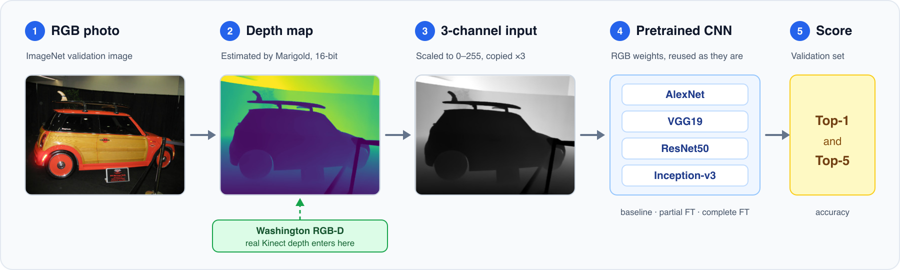
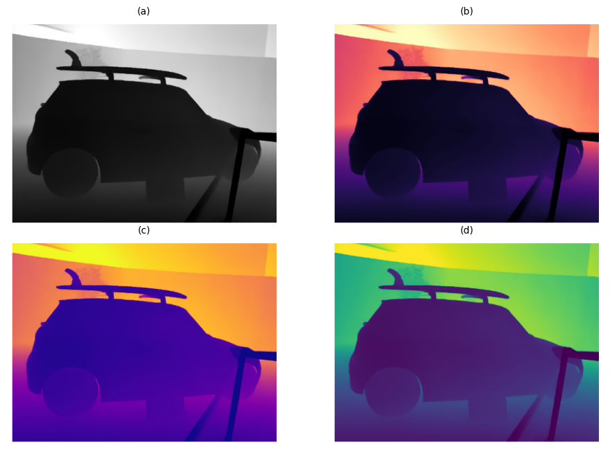
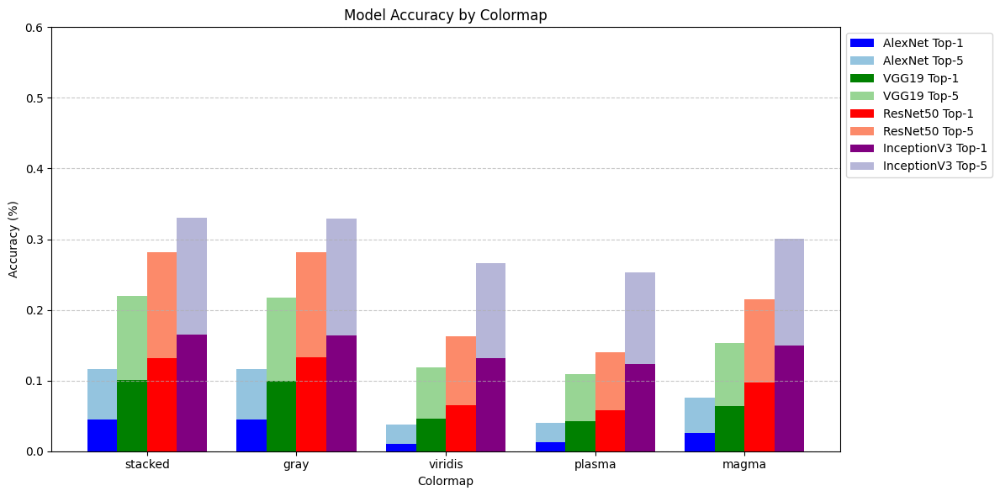

<div align="center">

# 🕶️ Privacy-Preserving Computer Vision

### Can off-the-shelf CNNs classify objects from depth images alone?

&nbsp;&nbsp;&nbsp; &nbsp;&nbsp;&nbsp; &nbsp;&nbsp;&nbsp; &nbsp;&nbsp;&nbsp; [](packages/paper/egpaper_final.pdf)


*Left: an ordinary RGB photo. Right: the depth map our models see instead. It shows shape and distance, but no faces, colors or textures.*

</div>

<br/>

### **Authors:** [Dario Furlan](https://github.com/dariofurlan) · [Dawit Andargachew](https://github.com/dawit-andargachew) &nbsp;|&nbsp; **Date:** June 8, 2025

---

## Overview

As privacy concerns grow, computer vision needs to move beyond RGB. Depth images are a natural fit: they capture the shape of a scene but not faces, clothing or colors. Most research on private vision relies on encrypted color images or custom architectures. We ask a simpler question: **can standard, widely available CNNs classify objects using depth alone?**

We test four pretrained networks (AlexNet, VGG19, ResNet50, Inception-v3) on depth-only inputs from two sources: depth *estimated* from ImageNet photos with the Marigold model, and *real* depth scans from the Washington RGB-D dataset.

### Headline results

| Dataset | Best result | Model |
|---|---|---|
| Washington RGB-D (real depth, 51 classes) | **92.23% Top-1**, 99.61% Top-5 | VGG19, partial fine-tuning |
| ImageNet 200-class depth subset | **47.95% Top-1**, 73.20% Top-5 | Inception-v3 (Top-1), ResNet50 (Top-5), complete fine-tuning |
| ImageNet 1k-class depth (1,000 classes) | **48.53% Top-1**, 74.53% Top-5 | Inception-v3, complete fine-tuning |

Fine-tuning matters a lot: on the 1,000-class task, complete fine-tuning gave nearly **3× the baseline accuracy** on average. See [Results](#results) for the full tables.

---

## Read the Paper

The final report and its LaTeX source are included, so the work can be reproduced or edited.

- 📘 [Final paper (PDF)](packages/paper/egpaper_final.pdf)
- 📂 [LaTeX source](packages/paper/)

---

## How It Works

### From a photo to a prediction

<p align="center">
  
</p>

*Real depth from Washington RGB-D skips the estimation step and joins at step 2.*

Pretrained CNNs expect 3-channel, 8-bit images, but depth maps have one 16-bit channel. We bridge that gap in two steps: scale the depth to 0–255, then spread it across three channels.

### Three ways to turn depth into 3 channels

<p align="center">
  
</p>

*The same depth map as (a) stacked or grayscale, (b) Magma, (c) Plasma and (d) Viridis.*

**Stacking** (copying the one channel three times) turned out to work as well as any colormap, so the fine-tuning experiments use it.

### Three training regimes

| Regime | What is trained | Used on |
|---|---|---|
| **Baseline** | Nothing. Pretrained RGB weights are tested as they are | ImageNet 1k-class depth |
| **Partial fine-tuning** | Only the last layers (for ResNet50, the last block and the classifier) | All three datasets |
| **Complete fine-tuning** | Every parameter | ImageNet 1k-class and 200-class depth |

Washington RGB-D is only partially fine-tuned: partial fine-tuning already reached about 90%, so complete fine-tuning wasn't worth its cost. Fine-tuning runs use an 80/20 train/validation split.

### Datasets

| Dataset | Depth source | Size used | Classes |
|---|---|---|---|
| **ImageNet 1k-class depth** | Estimated with Marigold | 50,000-image validation set | 1,000 |
| **ImageNet 200-class depth** | Random 200-class subset of the above | 10,000 images (50 per class) | 200 |
| **Washington RGB-D** | Real, captured with a Kinect | 41,877-image validation set | 51 |

Because of limited compute, we use only the validation portion of each dataset. The 200-class list is in [`imagenet_200_class_list.txt`](packages/core/ImageNet-200-classes/imagenet_200_class_list.txt).

---

## Results

### ImageNet 1k-class depth

| Model | Baseline Top-1 / Top-5 | Partial FT Top-1 / Top-5 | Complete FT Top-1 / Top-5 |
|---|---|---|---|
| AlexNet | 4.53 / 11.63 | 18.05 / 36.41 | **23.62 / 45.76** |
| VGG19 | 10.04 / 22.00 | 25.40 / 48.18 | **34.20 / 60.96** |
| ResNet50 | 13.18 / 28.16 | 32.36 / 57.87 | **44.95 / 71.90** |
| Inception-v3 | 16.48 / 33.05 | 22.31 / 44.57 | **48.53 / 74.53** |

<p align="center">
  
</p>

*Baseline accuracy by colormap. Stacked and grayscale inputs score highest.*

### ImageNet 200-class depth

| Model | Partial FT Top-1 / Top-5 | Complete FT Top-1 / Top-5 |
|---|---|---|
| AlexNet | 26.25 / 52.90 | 26.40 / 51.25 |
| VGG19 | 32.50 / 59.95 | 36.70 / 65.25 |
| ResNet50 | 44.30 / 71.15 | 47.75 / 73.20 |
| Inception-v3 | 38.70 / 64.15 | 47.95 / 72.80 |

### Washington RGB-D (partial fine-tuning)

| Model | Top-1 | Top-5 |
|---|---|---|
| AlexNet | 87.51 | 98.79 |
| VGG19 | **92.23** | **99.61** |
| ResNet50 | 88.48 | 99.31 |
| Inception-v3 | 89.45 | 99.08 |

### What we learned

- **Depth alone is enough for simple tasks.** On real depth with 51 classes, every model reached close to 90% Top-1.
- **Fine-tuning helps a lot.** It lifts accuracy well above the baseline, and complete fine-tuning generally beats partial.
- **Model ranking carries over.** Architectures that do better on RGB, such as Inception-v3 over AlexNet, also do better on depth.
- **Data is the bottleneck.** With few examples per class, the 1,000-class results stay limited. Scaling to the full ImageNet is future work.

The paper also lists future work: learned depth encodings in place of stacking, and extending the study to semantic segmentation.

---

## Notebooks

Everything was run in Jupyter notebooks, one per model and training regime.

| Dataset | Regime | AlexNet | VGG19 | ResNet50 | Inception-v3 |
|---|---|---|---|---|---|
| ImageNet 1k | Baseline | [notebook](packages/core/ImageNet-1k-classes/baseline/alexnet_baseline.ipynb) | [notebook](packages/core/ImageNet-1k-classes/baseline/vgg19_baseline.ipynb) | [notebook](packages/core/ImageNet-1k-classes/baseline/resnet50_baseline.ipynb) | [notebook](packages/core/ImageNet-1k-classes/baseline/inception_baseline.ipynb) |
| ImageNet 1k | Partial FT | [notebook](packages/core/ImageNet-1k-classes/partial_finetuning/alexnet_pft.ipynb) | [notebook](packages/core/ImageNet-1k-classes/partial_finetuning/vgg19_pft.ipynb) | [notebook](packages/core/ImageNet-1k-classes/partial_finetuning/resnet50_pft.ipynb) | [notebook](packages/core/ImageNet-1k-classes/partial_finetuning/inceptionv3_pft.ipynb) |
| ImageNet 1k | Complete FT | [notebook](packages/core/ImageNet-1k-classes/complete_finetuning/alexnet_ft.ipynb) | [notebook](packages/core/ImageNet-1k-classes/complete_finetuning/vgg19_ft.ipynb) | [notebook](packages/core/ImageNet-1k-classes/complete_finetuning/resnet50_ft.ipynb) | [notebook](packages/core/ImageNet-1k-classes/complete_finetuning/inceptionv3_ft.ipynb) |
| ImageNet 200 | Partial FT | [notebook](packages/core/ImageNet-200-classes/partial_finetuning/Alexnet_pft.ipynb) | [notebook](packages/core/ImageNet-200-classes/partial_finetuning/VGG19_pft.ipynb) | [notebook](packages/core/ImageNet-200-classes/partial_finetuning/Resnet50_pft.ipynb) | [notebook](packages/core/ImageNet-200-classes/partial_finetuning/Inception-v3_pft.ipynb) |
| ImageNet 200 | Complete FT | [notebook](packages/core/ImageNet-200-classes/complete_finetuning/Alexnet_ft.ipynb) | [notebook](packages/core/ImageNet-200-classes/complete_finetuning/VGG19_ft.ipynb) | [notebook](packages/core/ImageNet-200-classes/complete_finetuning/Resnet50_ft.ipynb) | [notebook](packages/core/ImageNet-200-classes/complete_finetuning/Inception_v3_pft.ipynb) |
| Washington RGB-D | Partial FT | [notebook](packages/core/washington-RGB-D/partial_finetuning/Alexnet_pft.ipynb) | [notebook](packages/core/washington-RGB-D/partial_finetuning/vgg19_pft.ipynb) | [notebook](packages/core/washington-RGB-D/partial_finetuning/Resnet50_pft.ipynb) | [notebook](packages/core/washington-RGB-D/partial_finetuning/Inception-v3_pft.ipynb) |

The ImageNet validation ground truth is at [`ILSVRC2012_validation_ground_truth.txt`](packages/core/ILSVRC2012_devkit_t12/ILSVRC2012_validation_ground_truth.txt), or you can download it from the 2012 challenge section of the [official ImageNet site](https://image-net.org/download-images). Smaller demos (depth estimation, colormaps, Washington RGB-D) are in [`packages/core/demo/`](packages/core/demo/).

---

## Getting Started

The notebooks share a small helper package, `vcs2425`, for colormaps, dataset loading and training and evaluation utilities (including Top-k accuracy).

**Environment used:** Debian 12.8, Conda 25.3.1, CUDA 12.4, Python 3.11, PyTorch 2.6. The pinned requirements file was exported on Linux (`linux-64`), so on other systems you may need to install the packages by hand.

From `packages/core`:

```bash
# 1. create the environment
conda create --name vcs-2425 --file requirements.txt

# 2. install the helper package
pip install -e .
```

The repository holds the code, notebooks and paper. The datasets themselves (ImageNet, Washington RGB-D, and the Marigold depth maps) are not stored here, so download them from their sources first. More detail is in [`packages/core/Installation.md`](packages/core/Installation.md).

---

## Repository Layout

```
packages/
├── core/        notebooks and the vcs2425 helper package
├── paper/       LaTeX source and final PDF
└── doc/         research notes and the figures used in this README
.devcontainer/   TeX Live container for editing the paper
```

---

## Credits and License

- **Marigold**, the diffusion-based model we used for depth estimation.
- **ImageNet** and the **Washington RGB-D Object Dataset**, the sources of our data.
- The full reference list is in the [paper](packages/paper/egpaper_final.pdf).

Released under the MIT License © 2025 Dario Furlan, Dawit Andargachew.
